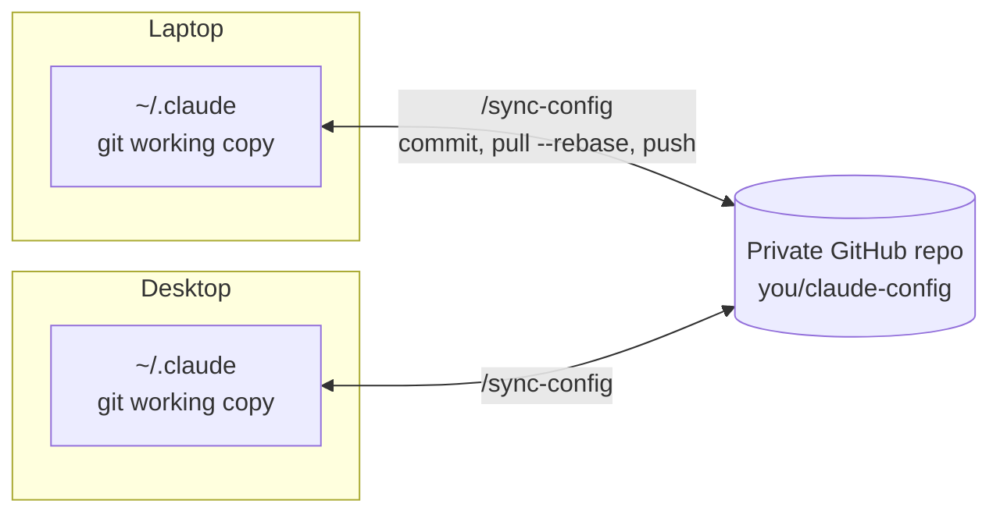
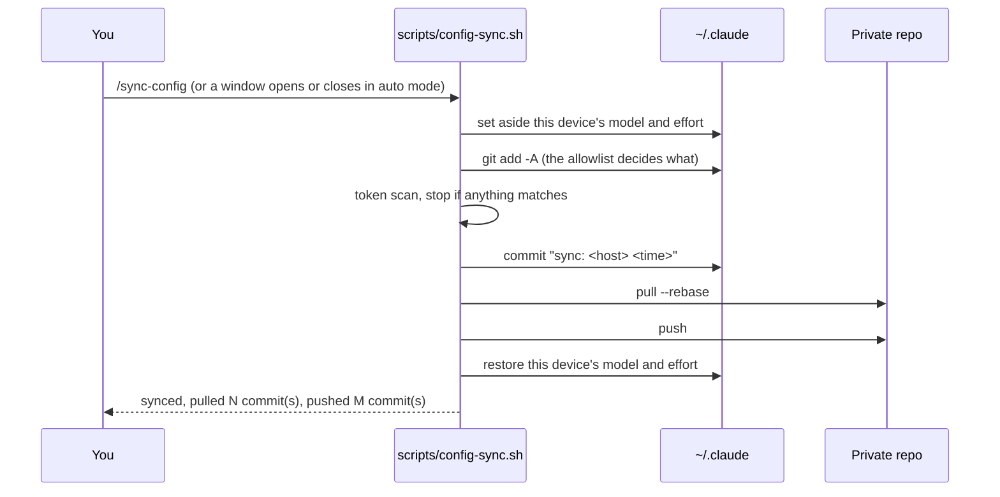
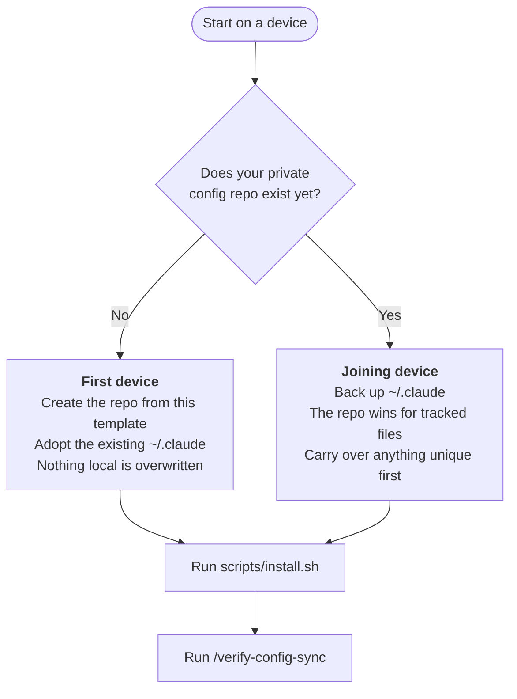
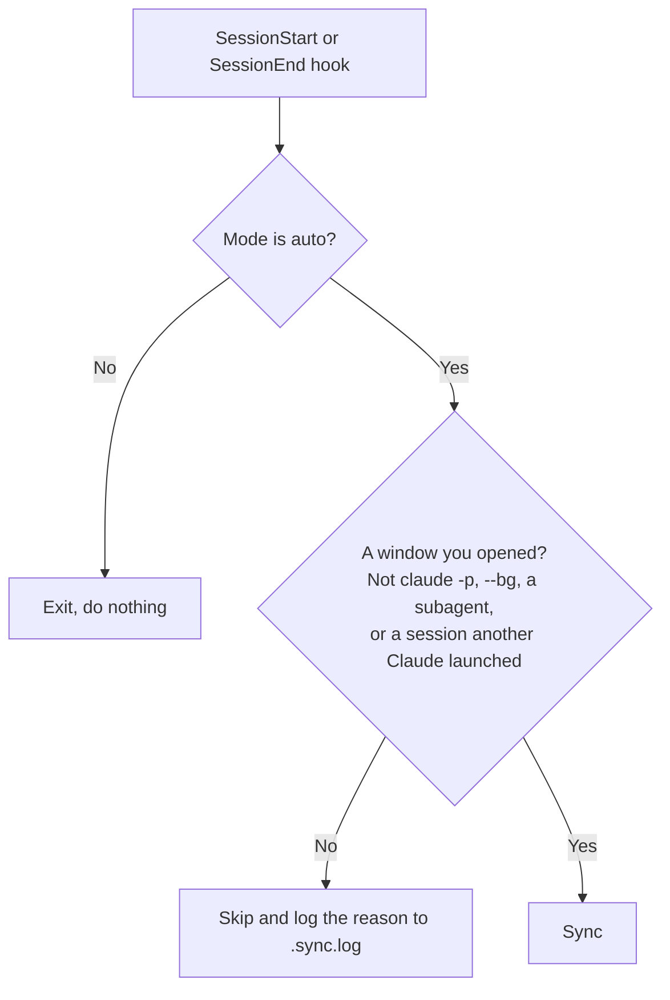
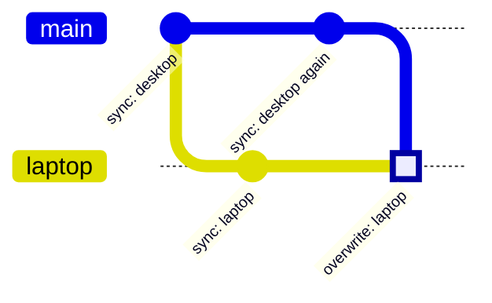

# ClaudeCodeSync

Keep your Claude Code setup in sync across every device you work on. Your instructions, skills, hooks, plugins, and settings live in a **private** git repo, and `~/.claude` on each device is a working copy of it.

This is a GitHub template. Create your own private copy from it, then let Claude Code set it up for you.

## Quick start

1. Click **Use this template → Create a new repository**. Name it something like `claude-config` and make it **Private**. Do not fork: a fork of a public repo is public.
2. In Claude Code on your first device, paste:

   ```text
   Set up ClaudeCodeSync for me. Read https://raw.githubusercontent.com/PoyoPoak/ClaudeCodeSync/main/SETUP.md and follow it.
   ```

3. Repeat step 2 on each other device. Claude works out whether a device is the first one or is joining an existing repo.

[SETUP.md](SETUP.md) is written for your agent, but every step in it is a plain shell command, so you can also follow it yourself.

## Why this exists

I switch between a laptop and a desktop a lot, often several times in the same day. I keep my own Claude Code setup in a private repo that syncs `~/.claude` between them. This template is a generalized copy of that setup with everything personal stripped out, so you can build the same thing for your own devices. Its companion, [AntigravitySync](https://github.com/PoyoPoak/AntigravitySync), does the same for Gemini CLI and Antigravity.

Claude Code's Remote Control is handy: I can drive a session on my desktop from my laptop. But it means leaving the main PC on, and I don't always want to. I also want to work with the code myself, to run it, test it, and click through it, beyond what Claude can test, verify, or use for me. So instead of remoting into one machine, every device carries the same Claude setup locally, and I pick up wherever I am.

## How it works



- **Allowlist.** `.gitignore` ignores everything in `~/.claude` except the paths it names. Credentials, memory, transcripts, and any new app data stay local by default.
- **Token scan.** Every sync checks staged files against `scripts/token-patterns.txt` and stops before committing if anything looks like a secret.
- **Per-device settings.** `model`, `effortLevel`, and `modelSettings` in `settings.json` stay per device, because `/model` and `/effort` rewrite them all the time.
- **Manual by default.** `/sync-config` syncs when you ask. Auto mode also syncs when a window opens and closes.
- **Self-healing setup.** `scripts/install.sh` adds the sync hooks, links configs from `~/.config`, installs declared plugins, and lists missing tools. It is safe to rerun.

One sync looks like this:



## What syncs

| Item | Location | How |
| --- | --- | --- |
| Settings, hooks, permissions, statusline command | `settings.json` | Tracked |
| Keybindings | `keybindings.json` | Tracked |
| Instructions | `CLAUDE.md`, `rules/` | Tracked |
| Hook and helper scripts | `hooks/`, `scripts/` | Tracked |
| Skills | `skills/`, except `skills/synced/` | Tracked |
| Commands, agents, tools, output styles, themes, workflows | Their named folders | Tracked once created |
| Configs under `~/.config` | `dotconfig/`, listed in `dotconfig/links.txt` | Symlinked |
| Plugins | `enabledPlugins`, `extraKnownMarketplaces` in `settings.json` | Declared, then installed per device |
| CLI tools | `scripts/tools.txt` | Reported as missing by `install.sh` and `/verify-config-sync` |

## What stays on each device

- **Secrets:** `.credentials.json`, `~/.claude.json` (account state and MCP servers)
- **Memory:** `projects/` (auto memory and transcripts), `agent-memory/`
- **Model and effort:** `model`, `effortLevel`, and `modelSettings` in `settings.json`. The repo never stores them: a joining device keeps its own (SETUP.md carries them over), and a fresh one starts from Claude Code's defaults.
- **Plugin files:** `plugins/`, which is large and reinstallable
- **Local data:** `history.jsonl`, `plans/`, `sessions/`, `jobs/`, caches, logs, and the sync's own `.sync-mode`, `.sync.log`, and `.sync.lock`

## Set up

Follow [SETUP.md](SETUP.md), or hand it to Claude Code with the prompt in [Quick start](#quick-start). There are two flows:



Before anything changes, Claude takes stock of what you already use (skills, plugins, hooks, statusline, terminal tools, configs under `~/.config`) and fits the sync around it.

## Sync

Each sync commits local changes, pulls with rebase, then pushes. `scripts/config-sync.sh` does the work.

| Command | Effect |
| --- | --- |
| `/sync-config` | Sync now, in either mode |
| `/sync-config overwrite` | Make the remote match this device. Other devices' changes are replaced, not merged |
| `/sync-config reset` | Make this device match the remote. Pending edits here are saved on a local backup branch, never pushed |
| `/sync-config manual` | Only `/sync-config` syncs this device. This is the default |
| `/sync-config auto` | Windows on this device also sync when they open and close |
| `/sync-config status` | Show the mode for this device |
| `/sync-config help` | List these commands |

Without Claude, run `bash ~/.claude/scripts/config-sync.sh` with `--now`, `--overwrite`, `--reset`, `--mode auto`, `--mode manual`, `--status`, or `--help`.

The mode is per device, stored in `.sync-mode`, which git ignores. A pull can never change it, and switching mode does not sync anything.

### Auto mode

The sync hooks in `settings.json` stay installed in both modes and exit right away in manual mode. In auto mode they run on:

- **Window opens** (`SessionStart`, source `startup`).
- **Window closes** (`SessionEnd`, except `/clear` and `/resume`). This stays offline if there is nothing to send.



- A window opened with `claude --continue` or `--resume` does not pull on open, but it syncs on close.
- A pulled `settings.json` reloads right away. Other pulled files may apply only from the next window.
- The guard relies on `CLAUDE_CODE_SESSION_ATTENDED` and `CLAUDE_PID`, which are not documented. If a Claude Code update changes them, auto sync fails closed and logs why. `/sync-config` does not use the guard, so it still works.

Sync before you switch devices, especially in manual mode.

### Overwrite and reset

Both settle a disagreement between this device and the remote without a force push.



- **Overwrite** merges the remote with `-s ours`. The result keeps this device's files and records the remote commits as merged, so the push is a normal fast-forward and the replaced commits stay in history.
- **Reset** saves this device's pending work on a local `reset-backup/<time>` branch, then runs `git reset --hard` to the remote. Nothing is pushed. Files outside the allowlist are not touched.

## Customize what syncs

| You want to | Do this |
| --- | --- |
| Sync another file or folder in `~/.claude` | Add `!/<name>` to `.gitignore` |
| Sync a tool's config under `~/.config` | Add its path to `dotconfig/links.txt`, then run `scripts/install.sh` |
| Make sure a CLI exists on every device | Add `<command> <install hint>` to `scripts/tools.txt` |
| Install a plugin on every device | Enable it in Claude Code. `enabledPlugins` and `extraKnownMarketplaces` sync, and `install.sh` installs what is missing |
| Keep another setting per device | Add its key to `KEYS` in `scripts/config-sync.sh` |
| Regenerate a file before each commit | Add `scripts/pre-sync.sh`. A non-zero exit stops the sync |

- **Paths.** Write `$HOME/...` instead of `/home/<you>/...` in hook and statusline commands, so they work on devices with a different username. `/verify-config-sync` warns about absolute paths outside your home.
- **Secrets.** Never put tokens in synced files. Keep them in environment variables or in `~/.claude.json` (MCP servers), which stays local. Add your own token formats to `scripts/token-patterns.txt`.
- **Executable bits.** Call scripts as `bash path/to/script.sh` in hooks. On WSL, `install.sh` sets `core.fileMode false`, so git does not track executable bits there.

## Verify

Run `/verify-config-sync` in Claude Code. It runs only when called, and it changes nothing. `/verify-config-sync test` also runs the test suite.

Without Claude:

```bash
bash ~/.claude/scripts/verify-config-sync.sh     # health check
bash ~/.claude/scripts/test-config-sync.sh       # offline tests with temporary repos
```

## Update from this template

Your repo does not share history with this template, so take updates file by file:

```bash
cd ~/.claude
git remote add upstream https://github.com/PoyoPoak/ClaudeCodeSync.git   # once
git fetch upstream
git diff HEAD upstream/main -- scripts skills/sync-config skills/verify-config-sync
```

Then check out the files you want with `git checkout upstream/main -- <path>`, run `bash scripts/test-config-sync.sh`, and `/sync-config`. Merge by hand any file you customized, such as `scripts/tools.txt`, `scripts/token-patterns.txt`, or `KEYS` in `scripts/config-sync.sh`. Or ask Claude: "Update my ClaudeCodeSync scripts from upstream."

## Platform support

- **Tested:** Linux and WSL2.
- **macOS:** untested. Install `flock`, `timeout` (coreutils), and `setsid` (util-linux) with Homebrew. Auto mode's guard reads `/proc`, which macOS does not have, so auto sync skips every run and logs why. Use `/sync-config`.
- **Windows:** use WSL.

## Troubleshooting

- **Conflict warning:** two devices changed the same line. Sync kept your local commit and did not push. `/sync-config overwrite` resolves it in favor of this device, and `/sync-config reset` in favor of the remote. To merge by hand, run `git pull --rebase` in `~/.claude`, resolve the conflict, then run `git rebase --continue` and `git push`.
- **Possible token warning:** sync stopped before committing. Remove the secret from the named file. If a token already reached GitHub, revoke it: removing it from git is not enough.
- **Pull or push failed:** check network and SSH with `ssh -T git@github.com`. A key with a passphrase needs `ssh-agent`, because the sync cannot prompt. Run `/sync-config` to retry.
- **Commit failed:** set `git config --global user.name` and `user.email` on this device.
- **Recover from an overwrite:** find the `overwrite:` commit with `git log` and restore files from its second parent: `git checkout <commit>^2 -- <path>`.
- **Recover from a reset:** run `git checkout reset-backup/<time> -- <path>`. Delete old backups with `git branch -D reset-backup/<time>`.
- **After an overwrite:** other devices' unsynced edits come back on their next sync. Run `/sync-config reset` on those devices first to drop them.
- **Auto mode stopped syncing:** run `/sync-config status`, then check the skip reasons in `~/.claude/.sync.log`. If a Claude Code update changed the session signals, update `skip_reason` in `scripts/config-sync.sh`.
- **Mode-only changes (`100755 => 100644`) on WSL:** a Windows tool writing over `\\wsl$` dropped the executable bit. Run `scripts/install.sh`, which restores the bits and sets `core.fileMode false`. That setting lives in `.git/config`, which does not sync, so run it once on each device.
- **`~/.config/...` is not a symlink:** a tool replaced the link with a regular file. Copy any wanted changes into `dotconfig/`, then run `scripts/install.sh`.

## License

[MIT](LICENSE)
