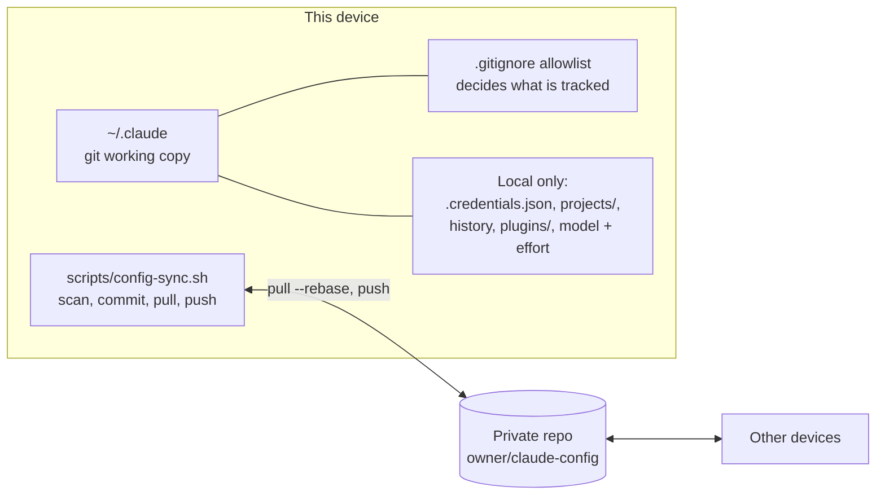
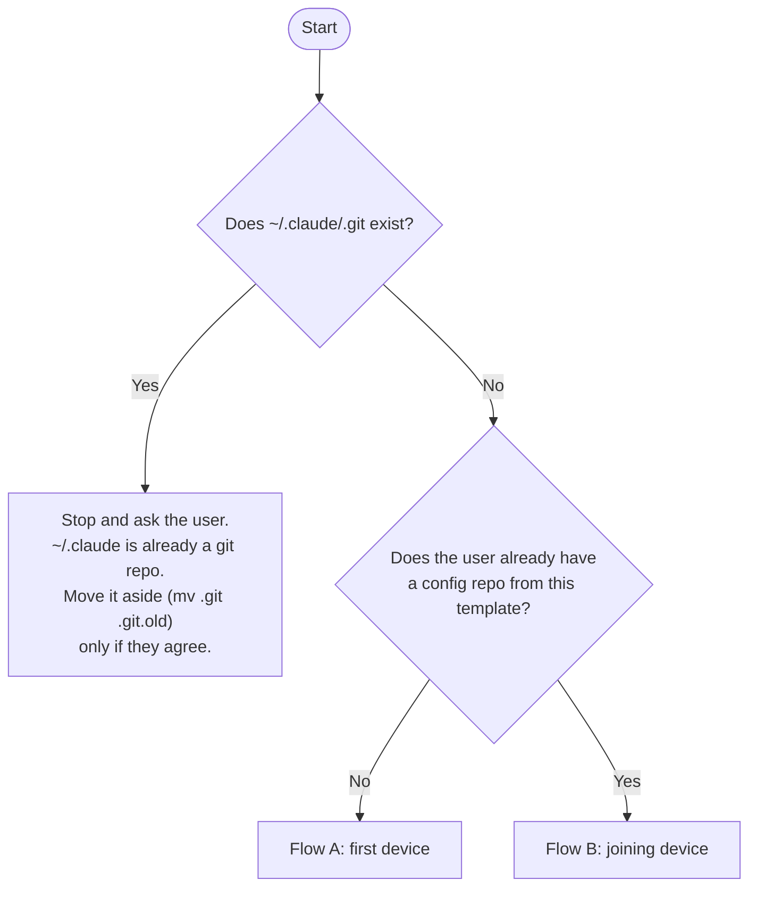
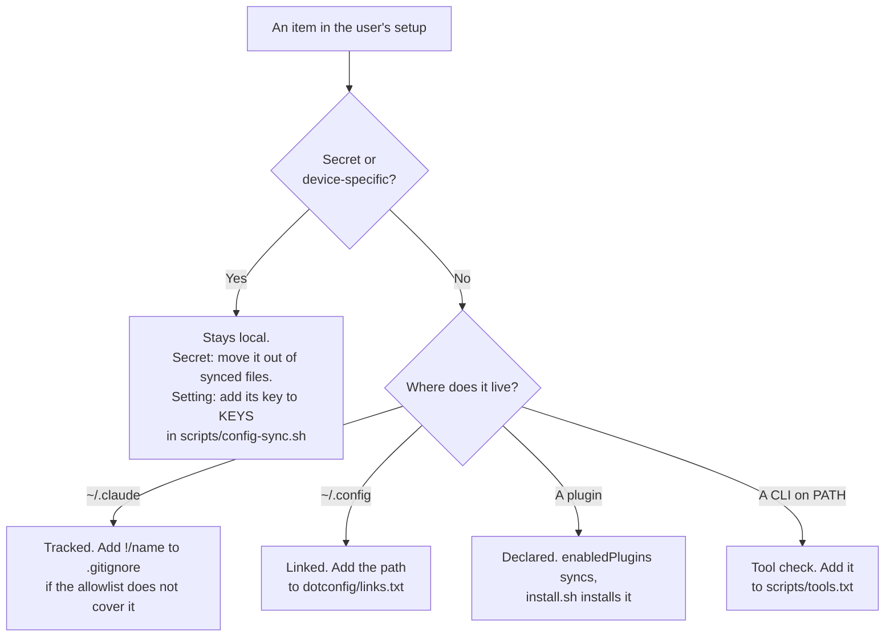
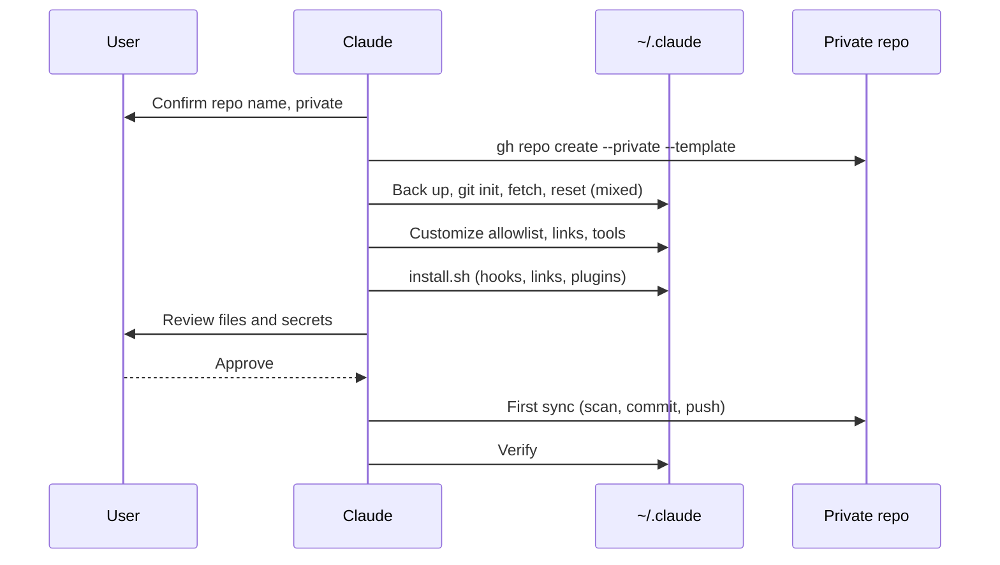
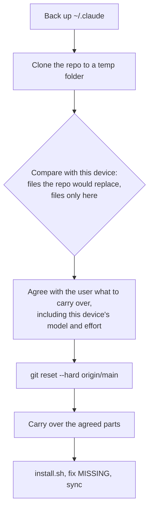

# ClaudeCodeSync setup guide

This guide is for **Claude Code** (or another coding agent) helping a user set up ClaudeCodeSync on one device. A human can follow it too: every step is a plain shell command.

**Your job:** make `~/.claude` on this device a working copy of the user's **private** config repo, without losing anything they already have, and fit the sync around the tools and setup they already use.

## How the system works

Read this first, so you can explain it and handle the cases this guide does not cover.



- `~/.claude` is a git repo. Its `.gitignore` starts with `/*` and allowlists paths with `!/<name>`, so anything not named stays local.
- `scripts/config-sync.sh` runs a sync: token scan, commit, `pull --rebase`, push. `/sync-config` runs it on demand; auto mode also runs it from `SessionStart` and `SessionEnd` hooks.
- `scripts/install.sh` prepares a device: adds the sync hooks to `settings.json`, symlinks configs listed in `dotconfig/links.txt` from `~/.config`, installs declared plugins, and reports CLIs from `scripts/tools.txt` that are missing. It is safe to rerun.
- `scripts/verify-config-sync.sh` is a read-only health check. `/verify-config-sync` runs it.
- [README.md](README.md) is the reference: what syncs, commands, customization, and troubleshooting.

## Ground rules

- **The repo must be private.** Confirm the visibility before the first push. Never push config to a public repo, and never fork the template (a fork of a public repo is public).
- **Secrets never get committed.** If you find one, name the file and the setting, never print the value, and help the user move it out: an `export NAME=...` line in their shell profile (`~/.bashrc`, `~/.zshrc`), which Claude Code inherits, or `~/.claude.json` for MCP servers. A secret that already reached GitHub must be revoked.
- **Back up before changing anything.** `cp -a ~/.claude ~/.claude.bak.<timestamp>`. The backup is local and still holds any secrets you moved out, so tell the user to delete it once they are happy.
- **Use absolute paths.** Your shell may start in a project folder, and `cd` may not carry over between commands. The commands below use `git -C ~/.claude` and `bash ~/.claude/scripts/...` for that reason; keep it that way, so you never stage, reset, or check the wrong repo.
- **Ask before** creating the repo, the first push, `git reset --hard`, and anything that deletes or replaces the user's files.
- **The user's setup wins.** Adapt the template to their tools, hooks, skills, and habits. Do not drop or rewrite something they use to make the template fit.
- **Keep the user informed.** Explain each phase in a sentence or two before you run it.

## Step 1: Check prerequisites

```bash
for t in git python3 flock timeout setsid claude gh; do command -v "$t" >/dev/null || echo "missing: $t"; done
gh auth status                      # gh is optional, but it creates the repo and checks it is private
ssh -T git@github.com               # "successfully authenticated" means SSH works
git config --global user.name; git config --global user.email
```

- Tested on Linux and WSL2. On macOS, install `flock`, `coreutils`, and `util-linux` with Homebrew, and tell the user that auto mode does not work there (its guard reads `/proc`); manual `/sync-config` does.
- Without SSH access to GitHub, help the user add a key, or use an HTTPS remote with a credential helper. The sync cannot prompt for a password.
- If `user.name` or `user.email` is empty, ask the user what to set. Suggest their GitHub noreply address (`<id>+<login>@users.noreply.github.com`) if they want their email private.

## Step 2: Pick the flow



Ask the user if you cannot tell. `gh repo list --limit 100 --json name,visibility,templateRepository` shows repos created from a template.

## Step 3: Take inventory of the user's setup

Do this in both flows, **before changing anything**. The goal is to know everything this device's Claude setup depends on, and decide with the user how each piece syncs.

Look at:

- **Instructions:** `~/.claude/CLAUDE.md`, `rules/`, and any files they import with `@path`.
- **Skills, agents, commands, output styles:** the folders in `~/.claude`. Note skills that ship scripts and the tools those scripts call.
- **`settings.json`:**
  - `hooks`: every command they run, and the scripts and CLIs behind them.
  - `statusLine`: the command, the binary it runs, and where that binary keeps its config.
  - `permissions`, `env`, and anything else that names a path, host, or project. Treat values in `env` as secrets until shown otherwise.
  - `enabledPlugins` and `extraKnownMarketplaces`. A marketplace added with `/plugin marketplace add` may only be in `~/.claude/plugins/known_marketplaces.json`, which does not sync. Add each marketplace an enabled plugin comes from to `extraKnownMarketplaces`, for example `"my-market": {"source": {"source": "github", "repo": "owner/repo"}}`, or joining devices cannot install the plugin.
  - Absolute paths like `/home/<name>/...` or `/Users/<name>/...`.
- **`keybindings.json`.**
- **CLIs the setup calls.** Collect the commands from hooks, the statusline, and skill scripts, then check each one with `command -v`. Common examples: terminal multiplexers and agent managers (herdr, tmux, zellij), statusline tools (ccstatusline), command-rewriting proxies, formatters, linters, and runtimes (node, bun, uv).
- **Configs under `~/.config`.** List the folder (`ls ~/.config`), then ask the user which entries belong to their Claude setup, such as a statusline layout or a multiplexer config. Look inside those for secrets.
- **MCP servers:** `claude mcp list`. They live in `~/.claude.json`, which never syncs. Note which ones need re-adding on each device, with that device's own keys.
- **Anything the setup reads from outside `~/.claude` and `~/.config`,** such as dotfiles or project paths. That is out of scope for this sync, but tell the user.

Then show the user a table like this, and get their confirmation:

| Item | Where | How it syncs |
| --- | --- | --- |
| Global instructions | `CLAUDE.md`, `rules/` | Tracked |
| `my-review` skill | `skills/my-review/` | Tracked |
| Statusline layout | `~/.config/ccstatusline/` | Linked: add to `dotconfig/links.txt` |
| Statusline binary | `ccstatusline` | Tool check: add to `scripts/tools.txt` |
| Agent manager hook | `hooks/herdr-state.sh`, `herdr` CLI | Tracked, plus a tool check |
| `superpowers` plugin | `enabledPlugins` | Declared, installed per device |
| GitHub MCP server | `~/.claude.json` | Stays local, re-add per device |
| `env.OPENAI_API_KEY` | `settings.json` | Secret: move to a shell variable before the first sync |

How to sync each kind of item:



## Flow A: first device

The repo starts with only the template's files. You adopt the existing `~/.claude` into it, and nothing local is overwritten.



**A1. Create the private repo.** Skip this if the user already clicked **Use this template**. Ask for a name (suggest `claude-config`), then:

```bash
name=claude-config                      # the name the user chose
owner="$(gh api user --jq .login)"
gh repo create "$owner/$name" --private --template PoyoPoak/ClaudeCodeSync
gh repo view "$owner/$name" --json visibility,sshUrl     # must say PRIVATE
```

Without `gh`, ask the user to create it in the browser: **Use this template → Create a new repository → Private**. GitHub fills a new repo from the template within a few seconds; if the fetch in A2 finds nothing, wait and retry.

**A2. Back up, then adopt.** Set `url` to the repo's SSH URL from A1.

```bash
url=git@github.com:OWNER/NAME.git      # the sshUrl from A1
cp -a ~/.claude ~/.claude.bak.$(date +%Y%m%d%H%M%S)
mkdir -p ~/.claude
git -C ~/.claude init -b main
git -C ~/.claude remote add origin "$url"
git -C ~/.claude fetch origin
git -C ~/.claude reset origin/main     # take the template's history; every local file stays as it is
git -C ~/.claude checkout -- .         # write the template's files (README.md, SETUP.md, scripts/, sync skills)
git -C ~/.claude branch -u origin/main
```

- `git reset` prints a long "Unstaged changes after reset" list of `D` lines. That is expected: the template's files are not on disk yet, and the next command writes them.
- `git checkout -- .` only writes paths the template tracks. The user's own files stay, untracked until the first sync. If the user already had a file at one of those paths, it is in the backup: tell them.
- If `fetch` finds no `main` branch, GitHub is still copying the template. Wait a few seconds and retry.

**A3. Fit the template to the inventory.** Edit, in `~/.claude`:

- `.gitignore`: add `!/<name>` for anything else in `~/.claude` that should sync.
- `dotconfig/links.txt`: one path under `~/.config` per line.
- `scripts/tools.txt`: one `<command> <install hint>` per line for each CLI the setup needs.
- `settings.json`:
  - Move every secret out, as the inventory table says (see Ground rules).
  - A path under the user's own home (`/home/<user>/...`) can become `$HOME/...` in hook and statusline commands, which run in a shell.
  - A path into another user's home, or to a file that does not exist, is probably stale. Ask the user. Prefer a command name on `PATH` plus a `scripts/tools.txt` entry over a hardcoded path.
- `extraKnownMarketplaces` in `settings.json`: add any marketplace the inventory found missing.
- `README.md`: update the "What syncs" table, so it describes this user's repo. Keep the rows of the `/sync-config` table as they are: `/sync-config help` reads them.

**A4. Prepare the device.**

```bash
bash ~/.claude/scripts/install.sh
```

It adds the two sync hooks to `settings.json`, keeping the user's own hooks and settings. Report anything it lists as `MISSING`.

**A5. Review what the first sync will commit.** Show the user the list and wait for approval.

```bash
git -C ~/.claude add -A && git -C ~/.claude status --short        # what will be committed
git -C ~/.claude grep --cached -I -l -E -f scripts/token-patterns.txt   # files that look like they hold a token
git -C ~/.claude reset -q                                         # unstage again; the sync stages for itself
```

No output from `git grep` (exit code 1) means no file matched. Also read `settings.json` (`env`, hook commands), hook scripts, and anything new in the list for secrets the patterns miss. Remove or exclude what the user does not want synced, and repeat.

**A6. Confirm the repo is private, then run the first sync.**

```bash
gh repo view "$(git -C ~/.claude remote get-url origin)" --json visibility --jq .visibility    # PRIVATE
bash ~/.claude/scripts/config-sync.sh --now
```

Then go to [Finish](#finish).

## Flow B: joining device

The repo already holds the user's config. For tracked files, **the repo wins**, so first find out what this device has that the repo does not.



**B1. Back up and compare.** Get the repo's SSH URL from the user, or with `gh repo view <owner>/<name> --json sshUrl`.

```bash
url=git@github.com:OWNER/NAME.git      # the repo's sshUrl
backup=~/.claude.bak.$(date +%Y%m%d%H%M%S) && cp -a ~/.claude "$backup" && echo "$backup"
tmp="$(mktemp -d)" && git clone -q "$url" "$tmp/repo"
diff -rq --exclude=.git "$tmp/repo" ~/.claude | grep -v "^Only in $HOME/.claude"   # files the repo adds or replaces
rm -rf "$tmp"
```

- For each file the repo would replace (often `CLAUDE.md`, `settings.json`, and skills), show the user the differences, and agree on what to keep from this device.
- Files that exist only on this device are left out above. They show up in B3, after the join.
- `model`, `effortLevel`, and `modelSettings` never reach the repo, so the reset removes this device's values. B3 puts them back.
- Run Step 3's inventory for tools and configs this device uses that the repo does not mention yet.

**B2. Join.** Ask before running the reset.

```bash
url=git@github.com:OWNER/NAME.git      # the repo's sshUrl
mkdir -p ~/.claude
git -C ~/.claude init -b main
git -C ~/.claude remote add origin "$url"
git -C ~/.claude fetch origin
git -C ~/.claude reset --hard origin/main   # the repo's version of every tracked file; untracked local files stay
git -C ~/.claude branch -u origin/main
bash ~/.claude/scripts/install.sh
```

**B3. Carry over and sync.** Merge the parts the user chose to keep from the backup into the working copy, and add any new entries to `.gitignore`, `dotconfig/links.txt`, or `scripts/tools.txt`. Put this device's model and effort back from the backup B1 printed (they stay local):

```bash
backup=~/.claude.bak.YYYYMMDDHHMMSS    # the path B1 printed
python3 - "$backup/settings.json" ~/.claude/settings.json <<'EOF'
import json, os, sys
old_path, new_path = sys.argv[1:]
old = json.load(open(old_path)) if os.path.exists(old_path) else {}
new = json.load(open(new_path))
new.update({k: old[k] for k in ("model", "effortLevel", "modelSettings") if k in old})
open(new_path, "w").write(json.dumps(new, indent=2, ensure_ascii=False) + "\n")
EOF
```

Then check what the next sync will push to every device:

```bash
git -C ~/.claude status --short     # untracked files are local files the allowlist covers; the sync adds them
```

`settings.json` also shows as modified because of the restored model and effort. The sync leaves those keys out of the commit.

Confirm each one with the user (or add an exclusion to `.gitignore`), check them for secrets as in A5, then:

```bash
bash ~/.claude/scripts/config-sync.sh --now
```

**B4. Device-local setup.** Install what `install.sh` listed as `MISSING`, have the user sign in with `/login` if needed, and re-add MCP servers from the inventory:

```bash
name=my-server; url=https://example.com/mcp; key=...    # from the inventory and the user
claude mcp add --transport http --scope user "$name" "$url" --header "Authorization: Bearer $key"
```

## Finish

1. Run the health check and fix every `FAIL`:

   ```bash
   bash ~/.claude/scripts/verify-config-sync.sh
   ```

   Every check that talks to GitHub needs the real network and `gh` login. A `WARN` about visibility means you must confirm the repo is private another way, for example on its GitHub page.

2. Ask which sync mode the user wants on this device:
   - **Manual** (the default): only `/sync-config` syncs. Predictable; sync before switching devices.
   - **Auto**: windows also sync when they open and close. Run `bash ~/.claude/scripts/config-sync.sh --mode auto`.
3. Tell the user to open a new Claude Code window, so `/sync-config` and `/verify-config-sync` load.
4. Report back in a short summary:
   - the repo URL and that it is private
   - what syncs, including anything you added to the allowlist, `dotconfig/links.txt`, or `scripts/tools.txt`
   - what stays on this device and needs setting up per device (MCP servers, secrets, sign-in)
   - the sync mode, and where the backup is
   - how to add the next device: open Claude Code there and paste the Quick start prompt from the README

If anything fails, use "Troubleshooting" in [README.md](README.md). Propose fixes, and apply them only after the user agrees.
